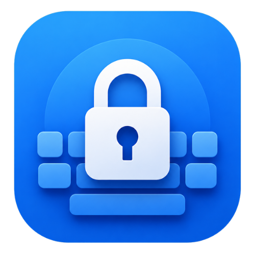
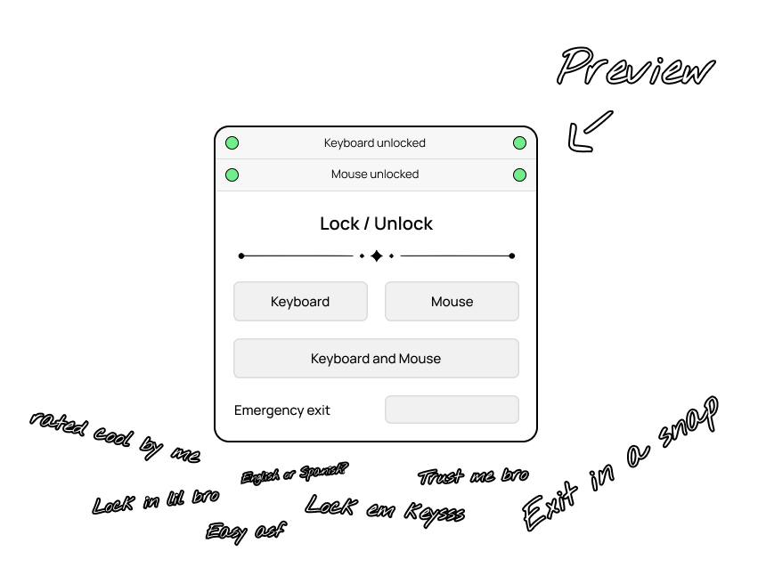

<p align="center">
    
</p>

<h3 align="center">keylock</h3>

<p align="center">Lock your keys with ease</p>

## Maintainer and attribution

This fork is maintained by **Harsh Mehta** at
[harshmehta1618/keylock_V1](https://github.com/harshmehta1618/keylock_V1).
It is based on the original Keylock project by **Axorax** and remains under
the GNU Affero General Public License v3.0. Original attribution and license
notices are retained.

## 💠 Preview

<p align="center">
    
</p>

## 🎛️ Config File

You can make a file called `keylock.toml` in the directory where the executable is. It will be used by the app to load the settings. All config options are:

```
[general]
lock = "ctrl+alt+l"   - Shortcut to lock the keyboard and mouse
unlock = "ctrl+q"     - Shortcut to unlock the keyboard and mouse
refresh_rate = 1500   - Check for lock state every x milliseconds (integer only)
quit_after = "never"  - Exit app after some time ("never" or milliseconds as integer, e.g. 5000)

[startup]
lock_keyboard = false - Lock keyboard on launch (true or false)
lock_mouse = false    - Lock mouse on launch (true or false)
```

If the configured unlock shortcut does not work, use the built-in emergency
unlock shortcut **Ctrl+Alt+Esc**. Closing the app also releases its input locks.
On Windows, Keylock allows injected keyboard and mouse events through while
blocking non-injected local input. Remote-control apps such as UltraViewer may
use injected events; other software that injects input may pass through too.

## macOS

Keylock can also run from source on macOS with Python 3.11 or newer. From the
project directory, install the dependencies with `python3 -m pip install pynput tomli-w pyinstaller`,
then start it with `python3 main.py`. To package it, run `sh build.sh` on the
Mac; PyInstaller builds must be made on macOS for macOS.

macOS will require granting the app (or the Terminal/Python process used to run
it) permission under **System Settings → Privacy & Security → Accessibility**
and **Input Monitoring**. The app must be restarted after changing permissions.
macOS input hooks are system-wide; Keylock cannot select only the built-in
keyboard/touchpad or reliably distinguish UltraViewer input on macOS. Test with
an external input device available before locking.

> [!Important]
> The "Mouse lock" button is a bit buggy. When you lock only mouse, if exit shortcut has "ctrl" then you can only use a-z characters and nothing else. This is not an issue when you lock only keyboard or both.

---

<p align="center"><a href="https://github.com/harshmehta1618/keylock_V1">Harsh Mehta — Keylock V1</a></p>
